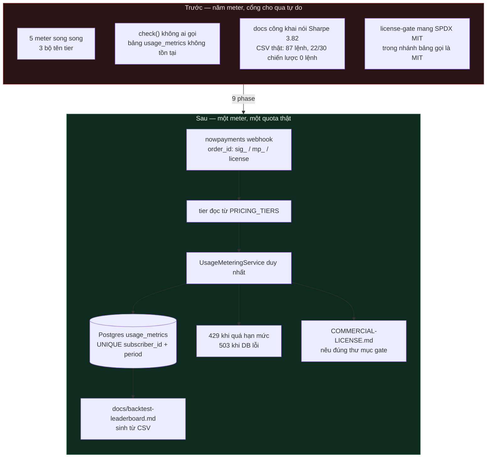

## Outcome

Biến lớp monetization open-core của repo từ kiến trúc tuyên bố thành hệ thống có thể bán: **một**
nguồn durable quyết định cả việc cho phép lẫn việc tính tiền, một bộ tier, một đơn vị MCU có định
nghĩa, một nhãn license nói đúng, leaderboard công khai tái tạo được từ artifact chạy thật, và cả
hai kênh thu tiền (SaaS hosted + marketplace) nối về cùng một entitlement.

## How It Works

- Cổng hạn mức hiện **không chặn được ai**: bảng `usage_metrics` không được migration nào tạo
  (đã tra 106 file), `recordCall` INSERT vào bảng không tồn tại bị `catch` + `logger.warn` nuốt,
  `getPeriodUsage` trả `0` khi lỗi — nên `check()` luôn thấy `periodUsed = 0` và luôn
  `allowed: true`.
- Không có ai gọi `check()`: middleware chỉ `recordCall` **sau** khi response xong, còn
  `checkUsage`/`getUsageSnapshot` (`subscription-service-d1.ts:117,127`) không có một caller nào.
  Quyết định "có cho phép" hiện không tồn tại trên đường request.
- Repo có **năm** meter song song (`BillingMeter` Map trong RAM, `signals-api/…core.ts` Postgres,
  hai `EventEmitter` ở `platform/metering` + `platform/billing`, và bảng `license_usage_daily`)
  dưới **ba** bộ tên tier không giao nhau, nên một khách không phải một thực thể ở hai chỗ.

## Architecture / Flow

## Implementation metadata

- **Branch:** `feat/opencore-monetization-real`
- **Plan:** `plans/261024-1142-opencore-monetization-real/plan.md`
- **Mode:** official (stable)
- **Route:** feature (via `/ak:cook`)
- **PR:** (điền sau khi ship)

## Acceptance Criteria

- [ ] `grep -rln "class UsageMeteringService\|class BillingMeter" src` → đúng 1
- [ ] Migration tạo bảng `usage_metrics` với đúng bộ cột code đang đọc, có test chứng minh
- [ ] Test chứng minh subscriber quá hạn mức bị từ chối, và số chặn = số `remaining`
- [ ] `grep -rn "BASIC\|PREMIUM"` trong gate + limits → 0
- [ ] `docs/mcu-definition.md` tồn tại; `TIER_QUOTAS` map vào định nghĩa viết
- [ ] `node scripts/generate-leaderboard.mjs && git diff --exit-code docs/backtest-leaderboard.md` → exit 0
- [ ] `grep -rn "getTierPrice" src` có call site trong handler; không còn import chết
- [ ] `COMMERCIAL-LICENSE.md` tồn tại; SPDX MIT bỏ khỏi file gate; git history không đổi
- [ ] `npx tsc --noEmit` 0 error; `npx eslint` file đã sửa sạch; `npm test` xanh; 71 probe pass

## Pipeline State

- [x] worktree + branch
- [x] investigate (đã kiểm chứng trong procedure `/ak:advise` trước đó + red-team plan)
- [x] plan (validate OK; red-team đã vá 3 lỗ hổng)
- [ ] issue + label `ready to cook`
- [ ] cook (9 phase)
- [ ] code review
- [ ] test
- [ ] docs
- [ ] ship PR
- [ ] review/fix/reply PR
- [ ] merge + watch CI
