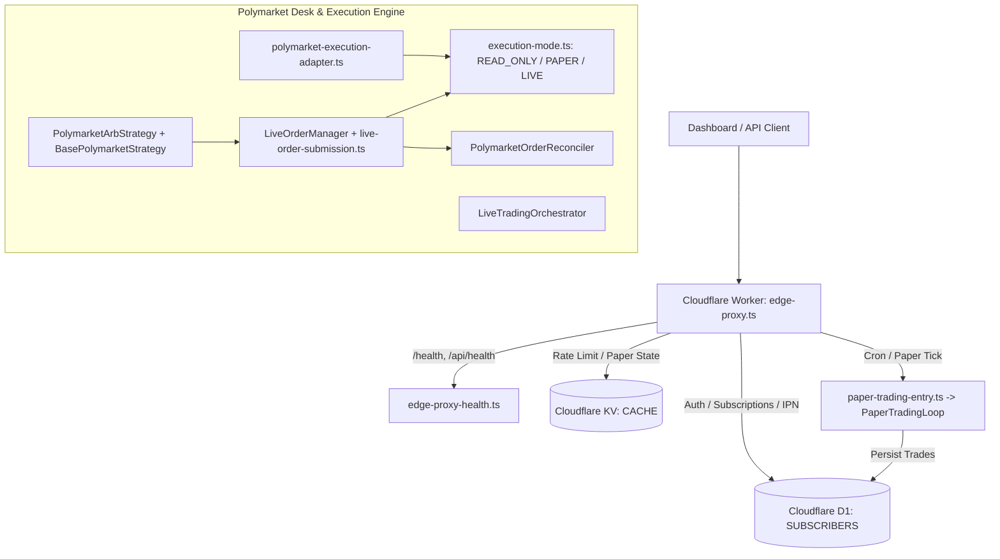

# 01 — System Map & Architecture (`audit-261101-golive-poly`)

## 1. End-to-End Topology

## 2. Isolation Between Environments
- **Production Edge (`wrangler.toml` top-level):** `name = "algo-trader"`, route `api.cashclaw.cc/*`, production D1 (`1f020fb2-9dd6-41ec-8db0-ee7fb95c5106`) and KV (`6e7b31a531594494bc25cd4c1ac4b7ae`).
- **Staging Edge (`[env.staging]`):** `name = "algo-trader-staging"`, `routes = []`, `workers_dev = true`, isolated staging D1 (`c4ef0537-5018-4847-848c-ea9b52721911`) and staging KV (`3094f632e1204628af4191e6e02dfab6`), verified by `scripts/verify-staging-preflight.ts`.
- **Execution Mode Isolation:** `LIVE_TRADING_ENABLED === 'true'` is required at every live entrypoint (`PolymarketAdapter.placeOrder`, `PolymarketConnectorAdapter.placeOrder`, `CexOrderExecutor.execute`, `LiveOrderManager.submitAndTrack`, `LiveOrderManager.submitOnly`, and `buildPolymarketAdapter`).
