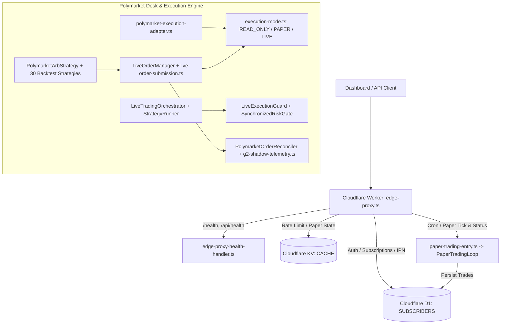

# 01 — System Map & Architecture (`audit-261101-golive-poly`)

## 1. End-to-End Topology

## 2. Isolation Between Environments
- **Production Edge (`wrangler.toml` top-level):** `name = "algo-trader"`, route `api.cashclaw.cc/*`, production D1 (`algo-trader-db`, `f29559f2-8e0b-461a-bd01-5665581beeee`) and KV (`6c7199c0259b42db943aa13b200d8ea1`).
- **Staging Edge (`[env.staging]`):** `name = "algo-trader-staging"`, `routes = []`, `workers_dev = true`, endpoint `https://algo-trader-staging.agencyos-openclaw.workers.dev/api/health`, isolated staging D1 (`algo-trader-staging`, `943fd11e-c81a-4342-afa6-7e80aa7a18df`) and staging KV (`1ef051223fde46629f0af6bf270e8315`), verified by `scripts/staging-preflight-check.ts` and `staging-manifest.json`.
- **Execution Mode Isolation:** `LIVE_TRADING_ENABLED === 'true'` and `LiveExecutionGuard` pre-execution checks are enforced across every live entrypoint (`PolymarketAdapter.placeOrder`, `PolymarketConnectorAdapter.placeOrder`, `CexOrderExecutor.execute`, `LiveOrderManager.submitAndTrack`, `LiveOrderManager.submitOnly`, `buildPolymarketAdapter` failing closed when `LIVE` is set without credentials, `TriModeDispatcher`, `OrderDispatcher`, `SynchronizedRiskGate.validateOrder`, and `UnifiedTradingLoop`).
